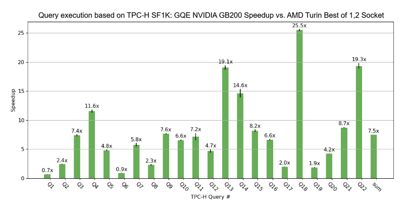

# GPU Query Engine (GQE)

`GQE` is a proof-of-concept SQL query engine for running data analytics queries on GPUs. Its purpose is to achieve speed-of-light performance and serve as a blueprint to inform your database engine design.



*Single-GPU speedup against DuckDB. Total GQE execution time for all 22 queries at scale factor of 1000: 9.15 s.*[^*]

## Build GQE

Please see the [contributing guide section](CONTRIBUTING.md#setting-up-your-build-environment) on setting up the build environment and building GQE and the SQL client.

## Run GQE

Start the node manager (it spawns one task manager per GPU):

```bash
./build/src/node_manager/gqe_node_manager \
  --address 127.0.0.1 \
  --port 50051 \
  --num-gpus 1 \
  --task-manager-binary ./build/src/task_manager/gqe_task_manager
```

To use multiple GPUs, raise `--num-gpus`. The node manager spawns one task manager subprocess per GPU and distributes query execution across them:

```bash
./build/src/node_manager/gqe_node_manager \
  --address 127.0.0.1 \
  --port 50051 \
  --num-gpus 8 \
  --task-manager-binary ./build/src/task_manager/gqe_task_manager
```

The node manager opens its TCP port only after all task managers have started and NVSHMEM bootstrap has finished, so a successful TCP connect is a reliable readiness signal.

Choose the shared memory layout with `--shmem-policy`. The default is
`single_arena_unplaced`, which uses one arena with placement determined by first touch.
To use one arena bound to each permitted CPU-bearing NUMA node, add
`--shmem-policy per_node_arenas_bound_overflow` to the node manager command. Allocations
try the calling thread's node first, then other nodes in increasing NUMA distance.

With the per-node policy, each allocation must fit within one arena. Free space across
arenas cannot be combined for a single allocation. For example, a 64 GiB segment on
two CPU-bearing NUMA nodes has roughly 32 GiB per arena, so a 40 GiB allocation fails
even when the segment is empty.

To drive the whole workflow from a single terminal, start the node manager in the background, redirect its logs to a file, and wait for the port to open before running clients:

```bash
./build/src/node_manager/gqe_node_manager \
  --address 127.0.0.1 \
  --port 50051 \
  --num-gpus 1 \
  --task-manager-binary ./build/src/task_manager/gqe_task_manager \
  > /tmp/gqe_node_manager.log 2>&1 &

until nc -z 127.0.0.1 50051; do sleep 0.5; done

# ... run load_tpch.py, gqe-cli, etc. ...

kill %+   # stop the most recent background job (the node manager)
```

`kill %+` sends SIGTERM; the node manager handles it gracefully, terminating its task managers and cleaning up shared memory before exiting.

If a process dies while holding a lock in the shared-memory segment, the segment's contents can no longer be trusted. When the node manager detects this, either because an operation finds the lock unrecoverable or because another process has recorded it in the segment, it fails the current operation and every later query or statement, terminates its task managers, removes the shared memory, and exits with status 101. Restart it and reload the tables.

The node manager exits with one of these statuses:

| Status | Meaning |
|---|---|
| 0 | Clean shutdown, including after SIGINT or SIGTERM while serving. |
| 100 | Any other failure, such as invalid arguments, a startup error, or a signal received before the server started. |
| 101 | The shared memory became unrecoverable. Restart the node manager and reload the tables. |
| 102 | The task managers could not be started or restarted after three attempts. Check the task manager logs, then restart the node manager and reload the tables. |

### Task manager failures

The task managers of a node form one group. If one of them exits, reports a fatal CUDA error, or does not answer an operation, the node manager stops the whole group and starts a new one. The shared memory and the loaded tables are kept, with one exception: the group is stopped without a grace period, so the stop can land while a task manager holds a lock in the shared memory, most likely during a `COPY` or `INSERT`. The shared memory is then unrecoverable, and the node manager exits with status 101 instead (see above).

- The operation that was running when the group failed fails with the Flight SQL status `Unavailable`. The node manager does not retry it, because an operation that caused the failure would fail the new task managers too. A client that wants to retry can do so, except for a write that may have changed a table: that table is flagged as unusable (see below), so drop it and load it again before retrying.
- A query or statement that arrives while the task managers are being replaced waits for the new group instead of failing. The wait ends when the new group is ready, or when the node tears down, which fails it. It is bounded only by the start attempts below, not by a time limit: one attempt can last as long as a bootstrap can take, which is minutes if a task manager hangs, and up to three attempts are made. Size client timeouts accordingly. Queries and statements run one at a time, so the ones queued behind the waiting one, and a `SET`, wait as well.
- An operation that does not finish within `--query-timeout` fails the same way. The node manager stops the task managers, because a task manager that did not answer may still be running the operation.
- Starting a group is tried up to three times, one second and then two seconds apart, also at startup. If every attempt fails, the node manager exits with status 102, because it cannot serve anything without task managers.
- A SIGINT, SIGTERM or SIGHUP that arrives while the task managers are being replaced, after the server is up, does not interrupt the attempt in progress, and the queries that wait for the new group keep the server from stopping. The node manager exits after the attempt ends, which is when the new group is ready and the waiting queries have returned, or when the last attempt has failed and the node tears down. Such a shutdown can therefore take as long as an attempt.

### Creating tables and loading data

Use `CREATE TABLE` followed by `COPY ... FROM '<directory>' (FORMAT parquet)`. The `COPY` source is a directory containing one or more Parquet files.

```bash
./rust/target/release/gqe-cli --server-url http://127.0.0.1:50051 --sql-file - <<'EOF'
CREATE TABLE sales (
  region    VARCHAR,
  sale_date DATE,
  amount    BIGINT
);
COPY sales FROM '/data/sales' (FORMAT parquet);
EOF
```

Tables live in GPU memory until the node manager exits, so later queries run without reloading.

#### Creating `EXTERNAL` tables from Parquet files without loading into memory
If desired (e.g. table size exceeds memory capacity), Parquet file-backed `EXTERNAL` tables can be created without occupying memory.

```bash
./rust/target/release/gqe-cli --server-url http://127.0.0.1:50051 --sql-file - <<'EOF'
CREATE EXTERNAL TABLE sales (
  region    VARCHAR,
  sale_date DATE,
  amount    BIGINT
) STORED AS PARQUET LOCATION '/data/sales';
EOF
```

Queries run against file-backed tables read the files directly from disk. Note that the `EXTERNAL` keyword is optional but is recommended for clarity.

### Running queries

From stdin:

```bash
echo 'SELECT region, sum(amount) FROM sales GROUP BY region' | \
  ./rust/target/release/gqe-cli \
  --server-url http://127.0.0.1:50051 \
  --sql-file -
```

From a file, saving the result to Parquet:

```bash
./rust/target/release/gqe-cli \
  --server-url http://127.0.0.1:50051 \
  --sql-file queries/q1.sql \
  --parquet q1_result.parquet
```

### TPC-H workflow

`scripts/load_tpch.py` issues the schema and `COPY` statements for the eight TPC-H tables. It takes a data directory as its positional argument; the directory must contain `ci_schema.sql` and one Parquet subdirectory per table (`customer/`, `lineitem/`, `nation/`, `orders/`, `part/`, `partsupp/`, `region/`, `supplier/`).

Both TPC-H helper scripts use `GQE_CLI` to locate the SQL client:

```bash
export GQE_CLI=./rust/target/release/gqe-cli
```

```bash
./scripts/load_tpch.py \
  --server-url http://127.0.0.1:50051 \
  /path/to/tpch/sf1
```

`scripts/run_tpch.py` runs one or more of the 22 TPC-H queries from a directory containing `q1.sql` ... `q22.sql`:

```bash
# Run a single query
./scripts/run_tpch.py --server-url http://127.0.0.1:50051 /path/to/tpch/queries 1

# Run several
./scripts/run_tpch.py --server-url http://127.0.0.1:50051 /path/to/tpch/queries 1 5 14

# Run all 22 queries
./scripts/run_tpch.py --server-url http://127.0.0.1:50051 /path/to/tpch/queries all

# Run all 22 queries and validate each against reference Parquet results
./scripts/run_tpch.py \
  --server-url http://127.0.0.1:50051 \
  --validate /path/to/tpch/reference_results/sf1 \
  /path/to/tpch/queries all
```

## Configuration

### Environment variables

| Variable | Default | Description |
|---|---|---|
| GQE_LOG_LEVEL | info | Enable log messages for this level or higher. |
| GQE_LOG_FILE | — | Write log messages to this file path. |
| GQE_EXECUTION_BACKEND | legacy_task_graph | Query-graph construction path. Values: `legacy_task_graph` (build the task graph directly) and `qep_task_graph` (lower and normalize a QEP, then adapt it to a task graph). The QEP path does not support multiple task-manager processes. |
| GQE_SOURCE_READER | oneshot | Storage reader selected during QEP lowering. Values: `oneshot`, `chunked`, and `deferred` (a reference iterator followed by a resolver). `legacy_task_graph` ignores it. `qep_task_graph` rejects `deferred`, and accepts `chunked` but merges each split's chunks into one. |
| GQE_NUM_WORKERS | 1 | Maximum number of worker threads per stage. |
| GQE_NUM_PARTITIONS | 8 | Maximum number of read tasks that can be generated for a single table. |
| GQE_INITIAL_QUERY_MEMORY | 10 GiB | Initial per-query memory pool size (in bytes). Ignored in multi-GPU mode (symmetric memory region is not growable). |
| GQE_MAX_QUERY_MEMORY | 90% of free device memory | Maximum per-query memory pool size (in bytes). |
| GQE_TRACK_QUERY_MEMORY | false | Track the query memory pool's peak usage per query, from task-graph construction through execution, above the bytes already allocated when the query starts. The task manager reports it as the `query_memory_peak_bytes` NVTX mark in the `GQE` domain and in a debug log line. Read at task-manager startup. Off by default because, under a CUPTI NVTX subscriber, such as the gqe-bench plugin, every distinct peak value makes each later NVTX event in the process slower, so long single-process runs slow down after tens of thousands of queries. |
| GQE_INITIAL_TASK_MANAGER_MEMORY | 10 GiB | Initial task-manager memory pool size (in bytes). Used across queries, e.g., for in-memory tables. |
| GQE_MAX_TASK_MANAGER_MEMORY | unlimited | Maximum task-manager memory pool size (in bytes). |
| GQE_JOIN_USE_HASH_MAP_CACHE | false | Allow multiple join tasks to reuse the same hash map. Either this option or the physical plan can enable caching; false does not override the plan. May increase device-memory usage. |
| GQE_JOIN_USE_UNIQUE_KEYS | true | Enable the specialized unique-key inner-join algorithm. Use GQE_JOIN_USE_PERFECT_HASH to disable perfect hashing. |
| GQE_JOIN_USE_PERFECT_HASH | true | Allow perfect hashing for eligible joins when the physical plan also enables it. False disables perfect hashing regardless of the plan. |
| GQE_JOIN_USE_MARK_JOIN | true | Use mark join for left semi/anti joins where LHS < RHS; falls back to cuDF if disabled. |
| GQE_AGGREGATION_USE_PERFECT_HASH | true | Enable perfect hashing for group-by aggregations. |
| GQE_FILTER_USE_LIKE_SHIFT_AND | true | Use shift-and optimization for LIKE patterns with middle segments ≤ 64 chars. |
| GQE_USE_AST_JIT | false | Use cuDF JIT evaluation for AST-compatible expressions instead of interpreted AST evaluation. |
| GQE_USE_LATE_MATERIALIZATION | true | Let the QEP backend keep filter, aggregate-condition, join, and non-terminal Top-K outputs masked or indirect until a consumer materializes them. When false, QEP gathers each such output, and every Top-K output, into an ordinary table at the relation that produces it. Ignored by the legacy backend. |
| GQE_JOIN_MATERIALIZATION_THRESHOLD | 0.1 | QEP late materialization only. After each join, gather the output columns that reference a relation when the output's row count is strictly below this fraction of that relation's row count, so the output stops pinning the whole relation. For references composed across joins, the relation is the original one, so the ratio is cumulative. Applied after residual filtering. Range `[0, 1]`; `0` disables it. |
| GQE_READ_USE_ZERO_COPY | true | Enable zero-copy reads for in-memory tables. When disabled, reads copy into a temporary buffer. |
| GQE_PARQUET_CHUNK_READ_SIZE | 1 GiB | Size in bytes of one output chunk emitted by the chunked Parquet reader. Splits land on Parquet page boundaries. |
| GQE_PARQUET_PASS_READ_SIZE | 4 GiB | Size in bytes of compressed and decompressed data held in memory while reading a pass of row groups in the chunked Parquet reader. |
| GQE_USE_OVERLAP_MTX | true | Use locks in memory read tasks to improve overlap and pipelining. Suboptimal with compressed columns. |
| GQE_USE_OPT_TYPE_FOR_SINGLE_CHAR_COL | true | Use optimized char type instead of string for single-char columns (currently only for TPC-H). |
| GQE_DECIMAL_TYPE | double | Representation for DECIMAL values. Values: `double` (FLOAT64), `decimal` (native fixed-point). |
| GQE_IN_MEMORY_TABLE_USE_SHARED_MEMORY | false | Use inter-process shared memory for the in-memory table. |
| GQE_USE_PARTITION_PRUNING | false | Enable partition pruning for in-memory tables. |
| GQE_ZONE_MAP_PARTITION_SIZE | 100000 | Rows per zone-map partition. Setting this to 0 disables zone maps (and therefore partition pruning). |
| GQE_NUM_SHUFFLE_PARTITIONS | 2 | Number of shuffle partitions for shuffle join. |
| GQE_COMPRESSION_FORMAT | none | Primary nvCOMP format for in-memory table compression. Values: `none`, `ans`, `lz4`, `snappy`, `cascaded`, `bitpacking` (Cascaded with RLE=0, Delta=0, and Bitpacking enabled; distinct from `bitcomp`), `gdeflate`, `deflate`, `zstd`, `gzip`, `bitcomp`. |
| GQE_COMPRESSION_RATIO_THRESHOLD | 1.0 | Compression-ratio threshold below which the primary format is skipped and columns are stored uncompressed (or with the secondary format). |
| GQE_COMPRESSION_CHUNK_SIZE | 16 | `n` in 2^n — nvCOMP chunk size in bytes. |
| GQE_SECONDARY_COMPRESSION_FORMAT | none | Secondary nvCOMP format. Same value set as the primary. |
| GQE_SECONDARY_COMPRESSION_RATIO_THRESHOLD | 3.0 | Minimum ratio for the secondary format to be considered. |
| GQE_SECONDARY_COMPRESSION_MULTIPLIER_THRESHOLD | 1.5 | Secondary is used when its ratio is at least this multiple of the primary's. |
| GQE_DECOMPRESSION_BACKEND | auto | nvCOMP decompression backend. Values: `auto`, `de`, `sm`. |
| GQE_USE_CPU_COMPRESSION | false | Use CPU compression for in-memory table compression. |
| GQE_COMPRESSION_LEVEL | 10 | LZ4 CPU compression level (1–12). Higher values compress better but more slowly. |
| GQE_IN_MEMORY_DUMMY_COPY_MULTIPLIER | 1.0 | Target total copy multiplier for batched memcpy in in-memory read tasks. Must be `>= 1.0`; `1.0` disables extra dummy memcpy work. |
| GQE_SM_MONITOR_METRIC | warps_active_elapsed | CUPTI PM metric `SmIdleMonitor` samples as the SM-utilization signal. Values: `warps_active_elapsed` measures average resident warps including idle gaps; `warps_active` measures achieved occupancy during active cycles; `cycles_active` measures the fraction of cycles with any active warp; `dram` measures DRAM throughput relative to peak. |
| GQE_SM_MONITOR_SAMPLE_INTERVAL_NS | 1000000 | `SmIdleMonitor` CUPTI PM sampling period, in nanoseconds (1 ms default). |
| GQE_SM_MONITOR_WINDOW_SAMPLES | 1 | Number of recent samples averaged by `SmIdleMonitor::get_smoothed_sm_util()`. `1` disables smoothing. |
| GQE_SM_MONITOR_DEBUG | false | Log the first few decoded CUPTI samples, for debugging metric selection. |
| GQE_SM_MONITOR_TRACE_JSON_FILE | — | Path to the JSON output file. If set, append one record (`{"t_us", "sm_util", "metric"}`) per CUPTI sample for offline analysis. |
| GQE_SM_MONITOR_TRACE_MAX_ENTRIES | 1000000 | Maximum number of records written to the SM monitor JSON trace before tracing stops. |

#### In-memory table serialization

An in-memory table can be snapshotted to disk and later reconstructed from that snapshot instead of
re-reading Parquet. Both directions are driven by optimization parameters.

| Variable | Default | Description |
|---|---|---|
| GQE_SERIALIZE_TABLES_TO_DISK | false | Snapshot each in-memory table to disk once the `COPY` that populated it completes. Mutually exclusive with `GQE_DESERIALIZE_TABLES_FROM_DISK`. |
| GQE_DESERIALIZE_TABLES_FROM_DISK | false | Reconstruct each in-memory table from its on-disk snapshot at `CREATE TABLE` time, instead of loading it from Parquet. Mutually exclusive with `GQE_SERIALIZE_TABLES_TO_DISK`. |

Both require the snapshot root, which is the `serialized_dataset_location` optimization parameter.
It has **no** environment variable and must be set on the session:

```sql
SET serialized_dataset_location TO '/path/to/dataset';
SET serialize_tables_to_disk TO true;  -- or: SET deserialize_tables_from_disk TO true
```

Enabling either flag without `serialized_dataset_location` fails.
The flags themselves are also settable with `SET serialize_tables_to_disk` /
`SET deserialize_tables_from_disk`.

Snapshots are written under a path keyed by the parameters that determine the on-disk column layout,
so a snapshot is only read back by a session using the same settings:

```
<serialized_dataset_location>/<table>/serialized_data/max_partitions-{N}/zmps-{M}/decimal_type-{double|decimal}/{compression}/{chunk_size}/rg-{i}/
```

Only in-memory tables participate; file-backed (Parquet) tables already own their files and are
skipped. Serialization does not support secondary compression.

Each snapshot directory holds a `_COMPLETE` marker, which serialization writes after every other
snapshot file. Deserialization refuses a snapshot without it. Serialization runs after the `COPY`
has committed, so if it fails, the `COPY` still succeeds and the error is logged. A previous
snapshot may remain loadable without the rows of that `COPY`: serialization keeps it when it cannot
remove its marker, and removes it on any later failure. Snapshots written by GQE versions without
the marker, or with the row-group directories directly under `decimal_type-*`, are refused and must
be regenerated once.

#### Failed writes

A `COPY` publishes the table's row groups as it runs, and nothing removes them if it fails. If a
failed `COPY` may have published data, the table is flagged as unusable. Queries and further writes
on it fail with an error asking to `DROP` it and load it again, and `DROP` works as usual. A
`COPY` into a boost-shared table that fails before publishing anything, for example on a bad input
path, leaves the table usable.

#### Morsel executor

| Variable | Default | Description |
|---|---|---|
| GQE_MORSEL_MAX_ROWS | unset | Maximum number of rows per morsel. Currently this bounds table outputs emitted by intermediate-state readers. Configured values must be positive. An unset value selects `intermediate_state_read_task::single_output`, which emits each materialized input once. Count-only state always emits once. |

See [docs/customized_parquet_reader/README.md](docs/customized_parquet_reader/README.md) for the additional `GQE_USE_CUSTOMIZED_IO` and `GQE_IO_*` variables that tune the customized Parquet reader.

### CUDA device and NUMA affinity

The GPUs GQE uses can be restricted by setting [the `CUDA_VISIBLE_DEVICES` environment variable](https://docs.nvidia.com/cuda/cuda-programming-guide/05-appendices/environment-variables.html#cuda-visible-devices). The node manager spawns one task manager per GPU (up to `--num-gpus`) and assigns each task manager a distinct device from the visible set.

The NUMA affinity of a device depends on the system topology. When memory kind is specified as `numa` or `numa_pinned`, GQE allocates tables on the NUMA node affine to the device used for table registration. In multi-process execution, NUMA node selection occurs per process.

### Partition pruning

If a table is split into multiple Parquet files, the lexicographical sort order of the file names has to correspond to the sort oder of the rows in the table, for pruning to be effective. This means that numbers in the file names have to be padded with leading zeros.

Good: `lineitem01.parquet`, ... , `lineitem09.parquet`, `lineitem10.parquet`

Bad: `lineitem1.parquet`, ... , `lineitem9.parquet`, `lineitem10.parquet`

## Experimental features

Optional components, each guarded by its own CMake flag. See the linked docs for build instructions and feature-specific environment variables.

- **Offline Substrait plan producer** — generates Substrait binary plans from SQL outside the client-server flow. See [docs/substrait_producer/README.md](docs/substrait_producer/README.md).
- **Customized Parquet reader** — a prototype reader that is more performant but limited in functionality. See [docs/customized_parquet_reader/README.md](docs/customized_parquet_reader/README.md).
- **Query compiler** — MLIR-based JIT that compiles relational operators into used NVVM IR kernels. See [docs/compiler/README.md](docs/compiler/README.md) for the design and [test/compiler/README.md](test/compiler/README.md) for building and running the MLIR tests.

## Tuning

- **Automatic compression calibration** — how to measure the decode throughput, copy bandwidth and SM advantage of a new GPU. See [docs/tuning/automatic-compression-calibration.md](docs/tuning/automatic-compression-calibration.md).

## Contributors

- Bret Alfieri
- Clemens Lutz
- Daniel Juenger
- Darshan Dinesh Kumar
- Dhruv Sundararaman
- Eric Schmidt
- Eyal Soha
- Hamish Nicholson
- Hao Gao
- James Xia
- Jeremy Kozdon
- Jiachun Li
- Kate Cheng
- Lingyan Yin
- Lu Li
- Miloni Dipak Atal
- Nico Iskos
- Nuttiiya Seekhao
- Rui Bao
- Siyuan Lin
- Tanmay Gujar
- Tyler Allen
- Viktor Rosenfeld
- Wei-Lun Wu
- Yadu Kiran
- Zhengru Wang

[^*]: The test results in this repository are derived from TPC-H decision support benchmark and aren’t comparable to published TPC-H results, as the test results in this repository do not comply with the TPC-H specification.
